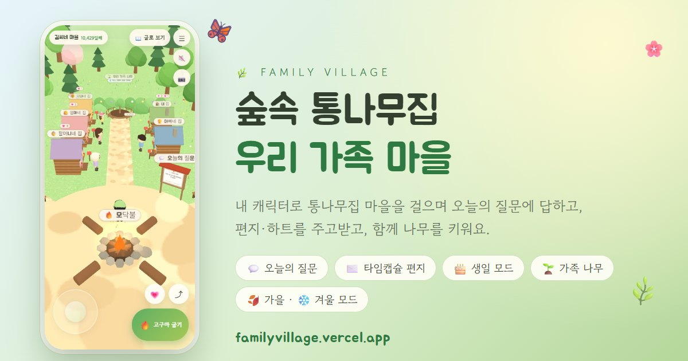

# 🌿 우리 가족 마을 — 가족이 같이 쓰는 3D 숲속 마을 (봄·여름 · 🍂 가을 · ❄️ 겨울)



가족이 휴대폰으로 들어와 **내 캐릭터로 숲속 통나무집 마을을 걸으며**, 오늘의 질문에 답하고, 편지와 하트를 주고받고,
생일을 축하하고, 함께 나무를 키우는 가족 홈페이지 템플릿입니다.
서버 없이 **HTML 파일 하나**로 동작하고, 이름·생일·질문·사진은 전부 `config.js` 한 파일에서 바꿉니다.
가족 모두의 글을 한곳에 모으려면 구글 시트 하나만 연결하면 돼요. (무료)
(이 폴더의 이름·생일·글·사진은 모두 **가상의 예시 가족 '김씨네'** 입니다.)

> 🌐 **살펴보기:** https://familyvillage.vercel.app · 💻 **코드:** https://github.com/SnUtah/FamilyVillage
> 📦 `한파일로_만들기.bat`으로 만든 `가족마을.html` 하나로도 열립니다.
> 💍 전작: [작은 결혼 마을](https://marriagevillage.vercel.app) — 같은 뼈대에 분위기와 기능을 가족용으로 바꿨어요.

## 들어오는 순서
1. 🔒 **가족 암호 (선택)** — 기본은 암호 없이 바로 들어와요. 시작 화면 오른쪽 위 **⚙️**(또는 메뉴 → 가족 암호)에서 걸면, 시트를 연결한 경우 가족 모두에게 적용되고 틀린 암호로는 글을 하나도 내려주지 않아요. 바꾸기·없애기도 ⚙️에서.
   시트를 연결해 주소를 공유했다면 **첫날 바로 걸어 두는 걸 추천해요.** (암호가 없으면 주소를 아는 누구나 글을 쓸 수 있어요)
2. 🙋 **캐릭터 고르기** — 가족 캐릭터 카드(3D 모습 그대로)를 옆으로 넘겨 나를 골라요. 이 휴대폰이 기억해서 다음엔 골라진 채로 열리고, 편지·답·하트가 이 이름으로 남아요. **🎨 꾸미기**로 옷·머리·안경·모자를 바꿀 수 있어요. (손님으로 구경하기도 있어요)
3. 🏡 **입장** — 오늘 처음 오면 출석 도장이 찍히고, 나에게 온 새 편지가 있으면 알려 줘요.

> 📱 **앱처럼 쓰기:** 마을 메뉴 → **📱 앱으로 설치**(또는 브라우저의 '홈 화면에 추가')를 누르면 🏡 아이콘이 생겨요. 부모님·조부모님도 한 번에 들어오고, 인터넷이 잠깐 끊겨도 마지막으로 본 마을이 열려요 (`sw.js`).

## 마을에 있는 것들

| 오브젝트 | 기능 |
|---|---|
| 🏘️ 가족 집 길 | 광장 북쪽에 **가족 나무를 가운데 두고 가로 한 줄**로 선 통나무집 (정면이 화면 쪽이라 걸으며 한 채씩 크게 보여요). 구성원마다 집 하나 (지붕·문·덧창이 그 사람 색, 굴뚝 연기). 집 앞에 그 사람이 서서 다가오면 바라보고 손을 흔들며 **오늘 남긴 답·최근 편지를 말풍선**으로 보여 줘요. 집을 누르면 프로필·하트·편지·연락 |
| 💗 하트 | 가족 집 앞에서 💗 버튼을 누르면 그 사람에게 하트 (하루에 한 번). 집 위에 받은 하트 수 |
| ✉️ 안부 우체통 | 받는 사람 고르기 (모두에게 / 한 사람에게), **⏳ 타임캡슐** (정한 날에 열림), 편지마다 👍😂🥹💗 반응과 **답장**. 내 집 우편함에 새 편지 깃발 |
| 🌷 가족 정원 | 편지 한 통 = 꽃 한 송이 (보낸 사람 색) |
| 💬 오늘의 질문 | 광장 게시판에 하루 한 질문. **내가 답해야 다른 가족의 답이 열려요.** 답마다 반응·답장, 지난 질문 모아 보기 |
| 📅 가족 달력 | 생일·기념일·제사·모임 달력과 D-day, 휴대폰 캘린더에 추가 (매년 반복) |
| 🎂 생일 모드 | 생일인 날 그 사람 집에 케이크·풍선, 고깔모자, 꽃가루와 축하 가락, 시작 화면 알림 |
| 🗳️ 가족 투표함 | "여행지 어디로?" 같은 투표. 누가 뭘 골랐는지 보이고, 마음이 바뀌면 다시 고르기. 새 투표 만들기 |
| 🌱 함께 키우는 나무 | 가족이 하루 한 번 물을 주면 씨앗 → 새싹 → 묘목 → 나무 → 꽃 → 열매가 열려요. 오래 안 오면 목말라요 |
| 👣 오늘 다녀간 가족 | 입구 이젤에 오늘 들른 가족, 내 출석 도장 |
| ❓ 가족 퀴즈 | "아빠의 첫 차 색은?" + **점수판** (누가 가족을 제일 잘 아나) |
| 🔥 모닥불 | 광장 가운데 모닥불에 고구마 굽기 🍠 |
| 📸 가족 포토존 | 같이 찍을 가족을 골라 (최대 5명) 양옆에 세우고 3·2·1 폴라로이드 → 공유·저장 |
| 🖼️ 가족 사진관 | 입구 오른쪽. 테마별 사진 전시 (여행 · 명절 · 아이들 자라는 모습 · 평범한 날 · 옛날 사진) |
| 🗺️ 모이는 곳 | 본가 주소 복사, 네이버/카카오/티맵, 교통·주차 |
| 🎨 캐릭터 꾸미기 | 옷 색·머리색(흰머리 포함)·머리 모양·안경·모자·아이 키 — 바꾼 모습은 내 집 앞의 나에게도 반영 |

### 🌿 🍂 ❄️ 계절 모드
| 계절 | 마을 | 화면 색 |
|---|---|---|
| 🌿 봄·여름 (기본) | 초록 숲에 연분홍 꽃나무 몇 그루, 들꽃, 민들레 홀씨, 나비, 허수아비 | 잎사귀 초록 |
| 🍂 가을 | 단풍·은행·주렁주렁 감, 코스모스, 떨어지는 낙엽, 고추잠자리, 낙엽 더미 | 감색 주황 · 크라프트지 |
| ❄️ 겨울 | 눈 덮인 땅·나무·지붕, 내리는 눈, 🎄 광장 크리스마스 트리, 집집마다 반짝이는 전구 | 하늘색 · 빨강 |
- 가족이 **☰ 메뉴 → 계절**을 누르면 🌿 → 🍂 → ❄️ 로 바뀌고, 그 휴대폰이 기억해요
- `config.js`의 `season`: `'green'`(기본) · `'autumn'` · `'winter'` · `'auto'`(날짜에 따라 3~8월 봄·여름, 9~11월 가을, 12~2월 겨울)
- 함께 키우는 나무도 계절 색을 따라가요 (모은 물·단계는 그대로)

### 처음 오는 사람을 위한 장치
- **🚶 자동 투어**, **📖 글로 보기**(3D 없이 한 페이지, 3D가 안 되는 휴대폰은 자동), **가+ 큰 글씨**, 휴대폰 뒤로가기 = 창 닫기
- **🌙 낮 · 노을 · 밤**: 계절마다 하늘색이 달라요. 밤에는 가로등·창문·모닥불(겨울엔 트리 전구)이 밝아요
- **🔊 마림바 배경음과 효과음**은 파일 없이 합성 (기본 꺼짐, 오른쪽 위 버튼)
- 이름표를 누르면 분수·게시판을 돌아서 찾아가요

### 테스트용 주소 꼬리표
| 주소 끝에 | 효과 |
|---|---|
| `#demo` | 가족 중 다음 생일인 사람의 생일 아침으로 시계가 맞춰짐 (생일 모드 미리 보기) |
| `#now=2027-08-21` | 원하는 날짜로 (오늘의 질문·타임캡슐·D-day가 그 날짜 기준) |
| `#night` / `#sunset` / `#day` | 하늘 고정 |
| `#autumn` / `#winter` / `#green` | 계절 미리 보기 |
| `#debug` | 콘솔에서 `__wv.goTo('tree')` 처럼 바로 이동 |

---

## 1. 내용 바꾸기 → `config.js`
메모장이나 VS Code로 열어서 따옴표 안의 글자만 바꾸면 됩니다.
- `name` (김씨네), `since` (가족이 시작된 날 → "함께한 지 ○일째"), `greeting`
- `members` — 구성원 4~8명. **`id`는 한 번 정하면 바꾸지 마세요** (편지·답이 이 id로 저장돼요). 생일은 `'월-일'`, 모습은 `look`
- `events` — 매년 반복은 `'월-일'` + `yearly: true`, 한 번뿐이면 `'연-월-일'`
- `questions` — 하루 하나씩 차례로 (`questionStart`가 1번 질문 날). 문자열만 적어도 돼요
- `polls`, `quiz`, `place`(모이는 곳), `tree`(나무가 자라는 물의 양), `museum`(사진 테마)
- 실제로 쓸 때는 **`samples: {}`** 로 예시 데이터를 비우세요
- 이름을 바꾸면 `index.html` 윗부분의 `<title>`·`og:title`도 같이 바꿔 주세요

> ⚠️ `config.js`와 사진은 **사이트 주소를 아는 누구나** 열어 볼 수 있어요. 전화번호·주소·아이 실명은 꼭 필요할 때만 넣으세요.
> 가족 암호는 사이트 파일에 적지 않아요. 마을의 ⚙️에서 정하면 **구글 시트의 스크립트**에 저장돼요.

## 2. 사진 넣기 → `photos/` 폴더
지금은 `demoPhotos: true` 라서 사진이 없어도 **캔버스로 그린 일러스트**가 사진관을 채웁니다.
실제 사진은 `demoPhotos: false`로 바꾸고 `photos/테마폴더/1.jpg, 2.jpg …` 순서로 넣은 뒤 `count`를 맞춰요. (긴 변 1600px 정도로 줄이기)

## 3. 가족 모두의 글을 한곳에 → 구글 시트
기본(`sheet: ''`)은 쓴 글이 **그 휴대폰에만** 저장돼요. 가족끼리 서로의 편지·답·하트를 보려면
[`tools/가족_시트_연결.md`](tools/가족_시트_연결.md) 대로 시트에 `tools/family-sheet.gs`를 붙여 웹 앱으로 배포하고, 주소를 `config.js`의 `sheet`에 넣어요. (10분)
- 🔒 (암호를 걸었다면) 가족 암호를 맞힌 사람만 글을 읽고 쓸 수 있어요. 시트 없이 건 암호는 그 휴대폰에서만 잠기는 미리보기예요
- 시트에서 행을 지우면 마을에서도 사라져요
- 연결이 끊겨도 쓴 글은 휴대폰에 보관했다가 자동으로 다시 보내요
- 타임캡슐은 열리는 날까지 내용이 내려가지 않아요

> 🤖 프로그램을 몰라도 돼요: `AI에게_맡기기_프롬프트.txt`를 Claude나 ChatGPT에 붙여 넣으면 가족 정보 넣기부터 시트 연결, 인터넷에 올리기까지 AI가 단계별로 안내해요.

## 4. 미리보기 · 한 파일 · 인터넷에 올리기
- **`index.html` 더블클릭** → 바로 열려요. (암호 없음, ⚙️에서 걸어 볼 수 있어요)
- **휴대폰으로 확인**: `미리보기.bat` → 같은 와이파이의 휴대폰에서 창에 적힌 `http://192.168.…:8000`
- `한파일로_만들기.bat` → 폴더 바로 위에 `가족마을.html` 하나 (카톡 전송용)
- 이 저장소는 **Vercel**에 연결되어 `main`에 푸시하면 https://familyvillage.vercel.app 에 자동 배포돼요. (`배포.bat`은 명령줄로 바로 올리는 방법)
- 카톡 미리보기 사진은 `og.jpg`, `index.html`의 `og:url`·`og:image`를 자기 주소로 바꿔 주세요
- 검색 엔진에는 나오지 않게 해 두었어요 (`noindex`)

## 조작법
| | 휴대폰 | PC |
|---|---|---|
| 걷기 | 화면 아무 곳이나 끌기 | WASD · 방향키 / 마우스로 끌기 |
| 그 자리로 가기 | 톡 누르기 | 클릭 |
| 구경하기 | 오른쪽 주황 버튼 / 이름표 누르기 | E · Enter |
| 하트 | 💗 (가족 집 앞이면 그 사람에게) | H |
| 창 닫기 | 뒤로가기 · 아래로 끌기 · ✕ | Esc |
| 점프 / 낮·밤 | ⤴ / 메뉴 | Space / N |

## 파일 구성
```
FamilyVillage/
├─ index.html               화면 뼈대 (더블클릭해서 열기)
├─ config.js                ⭐ 가족 설정 (여기만 수정)
├─ photos/ · music/         사진 (비어 있으면 일러스트) · 배경음악 (선택)
├─ css/style.css            디자인 (모바일 우선, 계절마다 색이 바뀜)
├─ js/app.js                프로그램 (src를 한 파일로 묶은 것, 3D 라이브러리 포함)
├─ 한파일로_만들기.bat · 미리보기.bat · 배포.bat
├─ AI에게_맡기기_프롬프트.txt  Claude·ChatGPT에 붙여 넣으면 처음부터 끝까지 안내
├─ tools/가족_시트_연결.md · tools/family-sheet.gs   가족 글을 구글 시트에 모으기
├─ tools/single.mjs · deploy-prep.mjs · demo-preview.html
└─ src/
   ├─ main.js      시작 화면 (⚙️ 암호 설정 · 🔒 암호 → 🙋 나 고르기), 메뉴, 출석 도장
   ├─ game.js      3D 마을: 조작, 길 찾기, 카메라, 투어, 가족 포토존, 낮·밤, 성능 조절
   ├─ world.js     하늘·풀밭·나무·날리는 것을 계절마다 (🌿 나비·홀씨 / 🍂 낙엽·잠자리 / ❄️ 눈·크리스마스 트리)
   ├─ season.js    계절 고르기·기억하기 (메뉴 '계절', config season)
   ├─ props.js     게시판·우체통·달력·투표함·퀴즈·모닥불·포토존·사진관 외관
   ├─ houses.js    🏘️ 통나무집 골목(겨울엔 지붕 눈·전구) + 집 앞 가족 + 🌱 함께 키우는 나무
   ├─ museum.js    사진관 내부        ├─ character.js  캐릭터 (안경·모자·아이 키)
   ├─ ui.js        팝업, 편지·답장·반응, 퀴즈 점수판, 사진 확대
   ├─ views.js     우리 가족·구성원 집·오늘의 질문·달력·투표·나무·꾸미기
   ├─ family.js    구성원·생일·질문·하트·출석·나무 계산
   ├─ store.js     글 보관 (휴대폰 ↔ 구글 시트, 보관 후 재전송)
   ├─ textview.js  📖 글로 보기     ├─ demo-photos.js 일러스트 사진
   ├─ sound.js     합성 마림바 · 효과음     ├─ common.js 날짜·시계·사진 목록
   └─ vendor/      3D 라이브러리 (three.js r160, MIT 라이선스)
```
> `config.js`와 `photos`만 바꿀 때는 다시 빌드할 필요가 없어요. `src`를 고쳤을 때만 `src/빌드.bat` (Node.js 필요).

개인·가족용 비상업 템플릿이에요. 고쳐 쓰고 나눠도 되지만 판매는 하지 말아 주세요.
