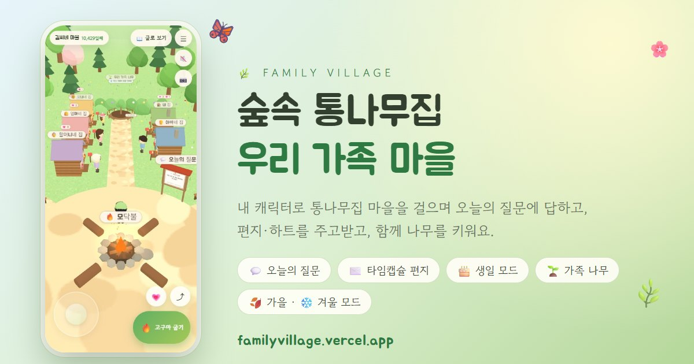

# 🌿 Our family village — a 3D forest village the whole family shares (spring-summer · 🍂 autumn · ❄️ winter)



A family website template. Everyone comes in on their phone and **walks around a village of log cabins in the woods as their own character**.
They answer the question of the day, swap letters and hearts, celebrate birthdays and grow a tree together.
It runs from **one HTML file** with no server. Names, birthdays, questions and photos all live in one file: `config.js`.
To gather everyone's posts in one place, connect one Google Sheet. (Free)
(All names, birthdays, posts and photos in this folder belong to **a made-up sample family, "The Kims" (김씨네)**.)

> 🌐 **See it:** https://familyvillage.vercel.app · 💻 **Code:** https://github.com/SnUtah/FamilyVillage
> 📦 It also opens as the single file `가족마을.html` made by `한파일로_만들기.bat`.
> 💍 Earlier project: [A little wedding village](https://marriagevillage.vercel.app) — the same frame, with the mood and features changed for families.

## How you come in
1. 🔒 **Family password (optional)** — By default you come straight in, no password. Set one with **⚙️** at the top right of the start screen (or menu → Family password). With a sheet connected, it applies to the whole family, and a wrong password gets no posts at all. Change or remove it with ⚙️ too.
   If you connected a sheet and shared the address, **we recommend setting it on the first day.** (Without a password, anyone who knows the address can post.)
2. ✨ **Create my character** — On the first visit, pick a **nickname**, then choose gender, age (child to senior), skin color, hairstyle (8 kinds), hair color, outfit color, glasses, hat and birthday (optional). The 3D preview changes as you go. Once you create it, **your own house** appears in the village (up to 10 houses). The phone remembers you, so next time it's just "Enter as ○○". There are no roles like Mom or Dad to pick, so **groups that aren't families** can use it too. To use a character made on another phone, pick it in **🙋 Switch character**. (You can also just look around as a guest.)
3. 🏡 **Enter** — On your first visit of the day you get a visit stamp, and you're told if a new letter has come for you.

> 📱 **Use it like an app:** village menu → **📱 Install as an app** (or the browser's "Add to Home Screen") adds a 🏡 icon. Parents and grandparents get in with one tap, and if the internet drops for a moment, the last village you saw still opens (`sw.js`).

## What's in the village

| Object | What it does |
|---|---|
| 🏘️ Family houses | Log cabins north of the square, **in one row with the family tree in the middle** (they face the screen, so you see each one up close as you walk). One house per member (roof, door and shutters in that person's color, chimney smoke). The person stands in front of their house, turns and waves when you come close, and shows **today's answer or their latest letter in a speech bubble**. Tap a house for their profile, hearts, letters and contact |
| 💗 Hearts | In front of a family house, tap 💗 to send that person a heart (once a day). The hearts they got show above the house |
| ✉️ Mailbox | Pick who gets it (everyone / one person), **⏳ time capsule** (opens on the day you choose), 👍😂🥹💗 reactions and **replies** on every letter. A flag goes up on your house's mailbox when a new letter comes |
| 🌷 Family garden | One letter = one flower (in the sender's color) |
| 💬 Question of the day | One question a day on the board in the square. **You see the others' answers after you answer.** Reactions and replies on each answer, and a list of past questions |
| 📅 Family calendar | Birthdays, anniversaries, memorial days and get-togethers with D-day counts. Add them to your phone's calendar (repeats every year) |
| 🎂 Birthday mode | On someone's birthday: cake and balloons at their house, a party hat, confetti and a birthday tune, and a note on the start screen |
| 🗳️ Family polls | Polls like "Where should we go on our trip?". You see who picked what, and you can pick again if you change your mind. Make new polls too |
| 🌱 The tree we grow together | When the family waters it once a day, it grows from seed → sprout → sapling → tree → blossoms → fruit. Leave it too long and it gets thirsty |
| 👣 Visited today | The easel at the entrance shows who stopped by today, and your visit stamps |
| ❓ Family quiz | "What color was Dad's first car?" plus a **scoreboard** (who knows the family best) |
| 🔥 Campfire | Roast sweet potatoes 🍠 at the campfire in the middle of the square |
| 📸 Family photo zone | Pick who's in the photo (up to 5). They stand on either side of you, 3 · 2 · 1, polaroid → share or save |
| 🖼️ Family photo gallery | To the right of the entrance. Photos by theme (trips · holidays · kids growing up · ordinary days · old photos) |
| 🗺️ Meeting place | Copy the family home's address, Naver / Kakao / TMAP, transport and parking |
| 🎨 Customize my character | Outfit color, hair color (gray hair too), hairstyle, glasses, hat, child height. Your new look also shows on you in front of your house |

### 🌿 🍂 ❄️ Seasons
| Season | Village | Screen colors |
|---|---|---|
| 🌿 Spring-summer (default) | Green forest with a few pale pink blossom trees, wildflowers, dandelion seeds, butterflies, a scarecrow | Leaf green |
| 🍂 Autumn | Red maples, yellow ginkgos, persimmons hanging heavy, cosmos, falling leaves, red dragonflies, leaf piles | Persimmon orange · kraft paper |
| ❄️ Winter | Snow on the ground, trees and roofs, falling snow, a 🎄 Christmas tree in the square, twinkling lights on every house | Sky blue · red |
- When someone taps **☰ menu → Season**, it changes 🌿 → 🍂 → ❄️, and that phone remembers it
- `season` in `config.js`: `'green'` (default) · `'autumn'` · `'winter'` · `'auto'` (by date: Mar–Aug spring-summer, Sep–Nov autumn, Dec–Feb winter)
- The tree we grow together follows the season's colors too (the water collected and its stage stay the same)

### For first-time visitors
- **🚶 Auto tour**, **📖 Text view** (one page without 3D; phones that can't run 3D get it automatically), **A+ larger text**, and the phone's back button closes a window
- **🌙 Day · sunset · night**: the sky color is different in each season. At night, the streetlights, windows and campfire (and the tree lights in winter) glow
- **🔊 Marimba background music and sound effects** are synthesized, no files needed (off by default, button at the top right)
- Tap a name tag and your character walks there, going around the fountain and the board
- **🌐 English · Korean**: the site opens in the device's language (Korean device → Korean, any other → English). The `EN · 한` button on the start screen and the 🌐 item in the ☰ menu switch it, and the choice is remembered. `?lang=ko` or `?lang=en` at the end of the address opens that language.
  Installed as an app, it's named in Korean on Korean devices (`manifest.ko.webmanifest`) and in English on others (`manifest.webmanifest`).

### Address add-ons for testing
| Add to the address | What it does |
|---|---|
| `#demo` | Sets the clock to the morning of the next family birthday (a preview of birthday mode) |
| `#now=2027-08-21` | Sets any date you want (the question of the day, time capsules and D-days follow that date) |
| `#night` / `#sunset` / `#day` | Fixes the sky |
| `#autumn` / `#winter` / `#green` | Previews a season |
| `#debug` | Jump straight to a place from the console, e.g. `__wv.goTo('tree')` |
| `?lang=ko` / `?lang=en` | Opens in Korean / English (goes before any `#`, e.g. `/?lang=ko#demo`) |

---

## 1. Change the content → `config.js`
Open it in Notepad or VS Code and change only the text inside the quotes.
- `window.FAMILY` holds the Korean text. `window.FAMILY_EN` at the end of the file holds the English text (see below).
- `name` (김씨네), `since` (the day the family began → "together for ○ days"), `greeting`
- `members` — people written in advance (optional, 0–8 people; `members: []` is fine). Everyone else creates their own character in the village. **Never change an `id` once it's set** (letters and answers are saved under it). Birthdays as `'month-day'`, looks in `look`
- `events` — `'month-day'` + `yearly: true` for every year, `'year-month-day'` for a one-off day
- `questions` — one a day, in order (`questionStart` is the day of question 1). A question can be just a string
- `polls`, `quiz`, `place` (meeting place), `tree` (how much water the tree needs to grow), `museum` (photo themes)
- For real use, empty the sample data with **`samples: {}`** (in `window.FAMILY_EN` too) and delete the example answers (`samples`) in `questions`
- If you change the name, also change the top of `index.html`: `<title>` (English title), `<meta name="title-ko">` (Korean title), `description`, and `og:title` / `og:description` (the KakaoTalk link preview). The link preview has only one language; the sample's is in English.
- The name of the app installed on a phone is in two files: `manifest.webmanifest` (English) and `manifest.ko.webmanifest` (Korean, for Korean devices). If you change the village name, change `name` and `short_name` in both. (`apple-mobile-web-app-title` in `index.html` is the iPhone home-screen name: English in `content`, Korean in `data-ko-content`.)

> ⚠️ Anyone who knows the site address can open `config.js` and the photos. Put in phone numbers, addresses and children's real names only when you really need to.
> The family password is not written in the site files. When you set it with ⚙️ in the village, it's saved in **the Google Sheet's script**.

### English version → `window.FAMILY_EN`
- Same shape as `window.FAMILY`, text only. Anything you leave out shows the Korean text.
- Ids, dates, numbers, phone numbers, links and colors always come from `window.FAMILY`.
- Lists (members, events, questions, polls, quiz, sample letters, photo themes) match up by position. Keep the same number and order of items as in the Korean block. Extra English items are ignored.
- Lists of plain text (poll options, quiz options, photo captions) replace the Korean list, so keep the same number and order. Votes and quiz answers are saved as the option's number, and `answer` comes from the Korean block.
- Write each question the same way as in the Korean block (just text, or `{ q: … }`).
- `banner` is a short theme name for the gallery banners (English only, optional).
- You have two choices:
  - Write your own English text in this block, including the village name (`name`) and the member names.
  - Delete the whole block. Everyone then sees the Korean content; buttons and menus still switch language.
- If you change the Korean sample content (village name, member names, meeting-place address or first question) but the English block still says "The Kims" (or has no `name`), the English block is skipped. English visitors then get English buttons and menus with the Korean content.

## 2. Add photos → `photos/` folder
Right now `demoPhotos: true`, so even with no photos, **illustrations drawn on a canvas** fill the gallery.
For real photos, set `demoPhotos: false`, put them in `photos/<theme folder>/` as `1.jpg, 2.jpg …` in order, and set that theme's `count` to match. (Shrink them to about 1600px on the long side.)
Photo captions go in `captions` (English ones in `window.FAMILY_EN`).

## 3. Gather everyone's posts → Google Sheet
By default (`sheet: ''`), posts are saved **only on that phone**. For the family to see each other's letters, answers and hearts,
follow [`tools/가족_시트_연결.md`](tools/가족_시트_연결.md): paste `tools/family-sheet.gs` into a sheet, deploy it as a web app, and put its URL in `sheet` in `config.js`. (10 minutes)
- 🔒 (If you set a password) only people who enter the family password can read and write posts. A password set without a sheet only locks that one phone, as a preview
- Deleting a row in the sheet removes it from the village too
- If the connection drops, posts are kept on the phone and sent again automatically
- A time capsule's text isn't sent out until its opening day

> 🤖 No coding needed: paste `AI에게_맡기기_프롬프트.txt` into Claude or ChatGPT, and the AI guides you step by step, from putting in your family's details to connecting the sheet and putting the site online.

## 4. Preview · one file · put it online
- **Double-click `index.html`** and it opens right away. (No password; you can try setting one with ⚙️)
- **To check on your phone:** double-click `미리보기.bat`, connect your phone to the same Wi-Fi as the PC, and type the `http://192.168.…:8001` address shown in the window.
- `한파일로_만들기.bat` → one file, `가족마을.html`, right above the project folder (for sending by KakaoTalk)
- This repository is connected to **Vercel**: pushing to `main` deploys it automatically to https://familyvillage.vercel.app. (`배포.bat` uploads it straight from the command line.)
- The KakaoTalk preview picture is `og.jpg`. Change `og:url` and `og:image` in `index.html` to your own address. (With `배포.bat`, putting your address in the `SITE_URL` environment variable does this for you.)
- It's kept out of search engines (`noindex`).

## Controls
| | Phone | PC |
|---|---|---|
| Walk | Drag anywhere on the screen | WASD · arrow keys / drag with the mouse |
| Go to a spot | Tap | Click |
| Look at something | Orange button on the right / tap a name tag | E · Enter |
| Heart | 💗 (in front of a family house, to that person) | H |
| Close a window | Back · swipe down · ✕ | Esc |
| Jump / day · night | ⤴ / menu | Space / N |

## Files
```
FamilyVillage/
├─ index.html               page skeleton (double-click to open)
├─ config.js                ⭐ family settings (edit only this): window.FAMILY (Korean) + window.FAMILY_EN (English)
├─ manifest.webmanifest · manifest.ko.webmanifest   app name when installed (English · Korean)
├─ photos/ · music/         photos (illustrations if empty) · background music (optional)
├─ css/style.css            design (mobile first, colors change with the season)
├─ js/app.js                the program (src bundled into one file, 3D library included)
├─ sw.js                    opens the last village you saw when you're offline
├─ 한파일로_만들기.bat · 미리보기.bat · 배포.bat
├─ AI에게_맡기기_프롬프트.txt  paste into Claude or ChatGPT for a guide from start to finish
├─ tools/가족_시트_연결.md · tools/family-sheet.gs   gather family posts in a Google Sheet
├─ tools/single.mjs · deploy-prep.mjs · demo-preview.html
└─ src/
   ├─ 빌드.bat       run after changing the source code → rebuilds js/app.js
   ├─ main.js        start screen (⚙️ password settings · 🔒 password → ✨ create / 🙋 pick a character), menu, visit stamps
   ├─ i18n.js        English / Korean: picking the language, the switch, the English config
   ├─ game.js        3D village: controls, finding the way, camera, tour, family photo zone, day · night, performance
   ├─ world.js       sky, grass, trees and things in the air for each season (🌿 butterflies · seeds / 🍂 leaves · dragonflies / ❄️ snow · Christmas tree)
   ├─ season.js      picking and remembering the season (menu 'Season', config season)
   ├─ props.js       outside of the board, mailbox, calendar, poll box, quiz, campfire, photo zone, gallery
   ├─ houses.js      🏘️ row of log cabins (snow on the roofs and lights in winter) + family in front + 🌱 the tree we grow together
   ├─ museum.js      inside the gallery
   ├─ character.js   characters (glasses · hats · child height)
   ├─ ui.js          popups, letters · replies · reactions, quiz scoreboard, photo zoom
   ├─ views.js       our family · member houses · question of the day · calendar · polls · tree · customizing
   ├─ family.js      members, birthdays, questions, hearts, visits, tree math
   ├─ store.js       keeping posts (phone ↔ Google Sheet, keep and send again)
   ├─ textview.js    📖 text view
   ├─ demo-photos.js illustration photos
   ├─ sound.js       synthesized marimba · sound effects
   ├─ common.js      date and clock, photo list
   ├─ util.js        shared 3D tools
   └─ vendor/        3D library (three.js r160, MIT license)
```
> When you change only `config.js` and `photos`, nothing needs rebuilding. Run `src/빌드.bat` only after changing code in `src` (needs Node.js).

A personal, family, non-commercial template. You may change it and share it, but please don't sell it.
